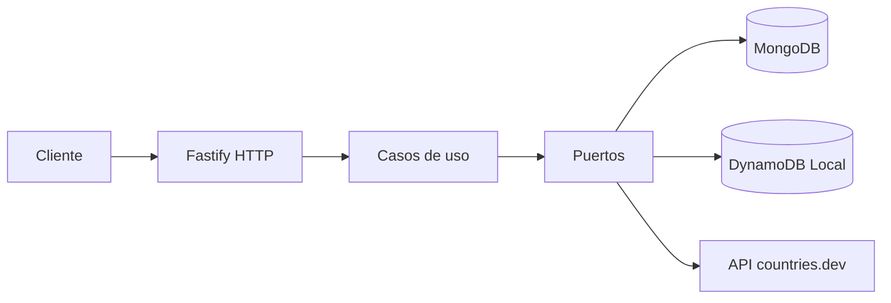

# AUCO — Prueba técnica Full Stack (servicio Node.js)

Servicio HTTP para crear y consultar validaciones. Cada validación se enriquece con información pública de un país, se guarda en **MongoDB** y se acompaña de un evento de auditoría en **DynamoDB Local**. No hay despliegue público: la entrega consiste en el repositorio y las respuestas técnicas solicitadas.

## 0.1. Pruebas en local: 

  - 1 
  - 2 npm run smoke 
  
 - 3 npm run. build and start 

-  npm run test


 
## 1. Requisitos cubiertos

| Requisito del correo | Implementación |
|---|---|
| `POST /validations` con nombre y documento | Fastify + Zod, responde `201 {"id":"..."}` |
| Enriquecimiento por API pública gratuita | `countries.dev`, consulta únicamente `countryCode` (predeterminado: `CO`) |
| Guardar registro | MongoDB con Mongoose |
| `GET /validations/:id` | Recuperación por MongoDB ObjectId |
| Evento por cada creación | Tabla `validation_audit` de DynamoDB Local |
| Llave de auditoría por documento y fecha | `document` (partition) + `eventAt` (sort: fecha ISO + `#id`) |
| Validaciones y errores externos | Zod, errores HTTP tipados, timeout, fallos de red, proveedor y formato |
| Mínimo tres pruebas | Pruebas unitarias y HTTP con Vitest, más smoke de integración opcional |
| README reproducible | Docker Compose, scripts, ejemplos, troubleshooting y anexos |
| Tres respuestas para el formulario | `docs/RESPUESTAS_FORMULARIO.md` |

**Importante:** enriquecer un registro con datos del país **no valida la identidad de la persona ni confirma la autenticidad del documento**. AUCO pide usar una API pública de cualquier temática para enriquecerlo, no una consulta de identidad.

## 2. Stack

- Node.js 22+, TypeScript (ESM), Fastify y Zod.
- Mongoose como adaptador de MongoDB.
- AWS SDK v3 apuntando **exclusivamente a DynamoDB Local**; no necesitas cuenta AWS.
- `countries.dev` como proveedor externo gratuito sin token. Requiere acceso a Internet al hacer POST.
- Docker Compose para base de datos y API. Vitest para pruebas automatizadas.
- Arquitectura hexagonal pragmática: puertos, adaptadores, dominio y casos de uso.

## 3. Arranque rápido: todo con Docker

**Requisito:** Docker Desktop (o Docker Engine + Compose). Ejecuta en la carpeta raíz:

```bash
# 1. Levantar el stack completo: MongoDB, DynamoDB Local y API Node.js
docker compose up --build -d

# 2. Consultar el estado de los contenedores
docker compose ps

# 3. Ver logs de arranque y errores (Ctrl+C para dejar de seguir)
docker compose logs -f api

# 4. Verificar la API
curl -i http://localhost:3000/health
```

La primera compilación puede descargar las imágenes y paquetes de npm. El contenedor API **espera MongoDB** y, al iniciar, **crea automáticamente la tabla** de DynamoDB Local si no existe. DynamoDB puede tardar algo en iniciar y la aplicación reintenta conectarse.

**Resultado esperado:** HTTP 200 con `{"status":"ok"}`. La API se expone **solo en `localhost:3000`**. MongoDB y DynamoDB Local se exponen en `localhost:27017` y `localhost:8000` respectivamente, sin acceso público.

### Si quieres correr Node.js fuera de Docker

Solo levanta las bases:

```bash
docker compose up -d mongodb dynamodb
cp .env.example .env
npm install
npm run dev
```

En esta modalidad se usan las direcciones `localhost` de `.env`. Para ejecutar tests (con cualquiera de las dos modalidades), necesitas dependencias locales (`npm install`). No edites `.env` para correr el servicio en Docker: Compose ya le pasa direcciones internas (`mongodb`, `dynamodb`).

## 4. Probar POST /validations

```bash
curl -i -X POST http://localhost:3000/validations \
  -H 'Content-Type: application/json' \
  -d '{"name":"Ana Torres","document":"12345678","countryCode":"CO"}'
```

`countryCode` es **opcional**; si se omite se utiliza `CO`. Se añadió para que el cliente pueda elegir qué país consultar sin perder el contrato mínimo requerido (nombre y documento). En el ejemplo solo se envía `CO` a la API externa, no el nombre ni el documento.

**Respuesta esperada: HTTP 201** (el ID es ilustrativo):

```json
{
  "id": "691e1c00aabbccddeeff0011"
}
```

Internamente:

1. Se validan `name` (2-120 caracteres), `document` (4-30, letras/números/guiones) y `countryCode` (2 letras ISO).
2. Se consulta `https://countries.dev/alpha/CO` con un timeout de 4 segundos.
3. Se verifica la estructura de la respuesta, y se extraen país, capital y moneda.
4. Se guarda el registro en MongoDB (`validations`), obteniendo `_id` de Mongo.
5. Se inserta un evento `VALIDATION_CREATED` en DynamoDB Local, con la llave `document` / `eventAt`.
6. Solo si ambas escrituras se completan se responde `201`.

## 5. Probar GET /validations/:id

Copia el `id` devuelto por el POST y reemplázalo aquí:

```bash
curl -i http://localhost:3000/validations/691e1c00aabbccddeeff0011
```

**Respuesta esperada: HTTP 200** (ejemplo):

```json
{
  "id": "691e1c00aabbccddeeff0011",
  "name": "Ana Torres",
  "document": "12345678",
  "country": {
    "code": "CO",
    "name": "Colombia",
    "capital": "Bogotá",
    "currencyCode": "COP"
  },
  "createdAt": "2026-11-18T21:20:00.000Z"
}
```

Un ID mal formado retorna `400 INVALID_ID`; un ID con formato válido pero que no está en la base retorna `404 VALIDATION_NOT_FOUND`.

## 6. Errores y escenarios especiales

Todos los errores controlados usan la estructura:

```json
{
  "error": {
    "code": "VALIDATION_ERROR",
    "message": "Los datos de entrada no son válidos.",
    "details": [{"field":"name","message":"Too small: expected string to have >=2 characters"}]
  }
}
```

| Código HTTP | Código de dominio | Motivo |
|---|---|---|
| 400 | `VALIDATION_ERROR` | Entrada inválida, falta de campos o campos desconocidos |
| 400 | `INVALID_ID` | ObjectId no válido |
| 404 | `VALIDATION_NOT_FOUND` | No existe el ID |
| 404 | `ROUTE_NOT_FOUND` | Ruta desconocida |
| 422 | `COUNTRY_NOT_FOUND` | País inexistente en el proveedor |
| 502 | `COUNTRY_API_UNAVAILABLE` | API externa responde error o hay fallo de red |
| 502 | `COUNTRY_API_INVALID_RESPONSE` | Respuesta JSON inválida o formato inesperado |
| 503 | `DATABASE_UNAVAILABLE` | Error de MongoDB |
| 503 | `AUDIT_UNAVAILABLE` | Dynamo falló; se pudo compensar el registro Mongo |
| 503 | `PERSISTENCE_INCONSISTENT` | Falló Dynamo y también la compensación; requiere revisión |
| 504 | `COUNTRY_API_TIMEOUT` | La API externa tardó demasiado |
| 500 | `INTERNAL_ERROR` | Error no controlado, sin revelar secretos |

**Consistencia entre bases:** MongoDB y DynamoDB no tienen una transacción común. Si DynamoDB falla tras crear el registro Mongo, el servicio intenta borrarlo y responde `503`. Si falla esa reversión, responde `PERSISTENCE_INCONSISTENT`; esto **no es atomicidad garantizada** y está documentado como una mejora futura de tipo outbox transaccional en [decisiones técnicas](docs/DECISIONES_TECNICAS.md).

## 7. Tests automatizados

Con Node.js 22+ y dependencias instaladas:

```bash
npm install
npm run typecheck
npm test
npm run test:coverage
```

- **Unitarios**: casos de uso, API externa, persistencia fallida, fallos de auditoría y compensación.
- **HTTP**: `Fastify.inject` comprueba cuerpos, validaciones, respuestas correctas, errores y rutas.
- **Integración real** (requiere Docker Compose funcionando, npm install y acceso a countries.dev):

```bash
npm run smoke
```

El script de smoke crea una validación de prueba, consulta su ID, verifica respuestas 400/404 y **consulta DynamoDB Local** para confirmar que existe el evento `VALIDATION_CREATED` con ese mismo ID. Utiliza un documento sintético `TEST<timestamp>`.

Ver la matriz completa: [docs/MATRIZ_DE_ESCENARIOS.md](docs/MATRIZ_DE_ESCENARIOS.md).

## 8. Arquitectura

```text
src/
├── domain/
│   ├── entities/validation.ts          # Modelos puros
│   ├── ports/                         # Interfaces hacia el exterior
│   └── errors/app-error.ts            # Errores tipados
├── application/use-cases/
│   ├── create-validation.use-case.ts  # POST, orquestación y compensación
│   └── get-validation.use-case.ts     # GET
├── infrastructure/
│   ├── config/env.ts                  # Variables de entorno
│   ├── countries/                     # Adaptador HTTP proveedor público
│   ├── mongodb/                       # Mongoose + repositorio
│   └── dynamodb/                      # AWS SDK + tabla + auditoría
├── interfaces/http/
│   ├── validation.schemas.ts          # Validación de entrada
│   └── build-app.ts                   # Rutas Fastify y respuestas HTTP
└── main.ts                            # Inyección de dependencias y arranque
```

Flujo de dependencias: `HTTP → casos de uso → puertos ← adaptadores Mongo / Dynamo / proveedor`. Los casos de uso no importan Fastify, Mongoose ni SDK AWS.



## 9. Estructura de la auditoría DynamoDB

Tabla: `validation_audit`, creada al inicio de la aplicación.

```json
{
  "document": "12345678",
  "eventAt": "2026-11-18T21:20:00.000Z#691e1c00aabbccddeeff0011",
  "validationId": "691e1c00aabbccddeeff0011",
  "action": "VALIDATION_CREATED",
  "createdAt": "2026-11-18T21:20:00.000Z"
}
```

- **Partition key:** `document` (string), para agrupar y consultar eventos del mismo documento.
- **Sort key:** `eventAt` (string), ISO UTC concatenado con `#id`, para ordenar eventos y evitar colisiones de milisegundos.
- `PutCommand` utiliza una condición para evitar sobrescrituras por llave repetida.

No hay índices adicionales en Dynamo, ya que los requisitos solo mencionan consultas de registro en Mongo y escritura de auditoría.

## 10. Comandos útiles

```bash
# Seguir logs de todos los servicios
docker compose logs -f

# Detener los contenedores conservando los datos
docker compose down

# Volver a levantar usando datos persistidos
docker compose up -d --build

# ATENCIÓN: borra datos y volúmenes locales de ambos motores
docker compose down -v

# Comprobar compilación local
npm run build

# Ejecutar versión compilada local
npm start
```

### Solución de problemas

- **No funciona `/health`**: ejecuta `docker compose ps` y `docker compose logs --tail=150 api`; la API no escucha hasta que Mongo conecte y Dynamo tenga tabla activa.
- **Los puertos 3000/8000/27017 están ocupados**: detén servicios previos en tu computador o cambia los puertos de host en Compose y ajusta `API_URL` / `DYNAMODB_ENDPOINT` para el smoke.
- **El POST devuelve 502/504**: comprueba que tu equipo o el contenedor tiene salida a Internet y que `https://countries.dev/alpha/CO` responde. Las pruebas unitarias funcionan sin Internet.
- **La API local fuera de Docker no conecta**: confirma `cp .env.example .env` y usa `localhost` en las direcciones, no `mongodb` / `dynamodb` (esos son nombres DNS dentro de Docker).
- **Cambiaste credenciales o parámetros de Dynamo**: en local se usan credenciales ficticias y la región `us-east-1`. `-sharedDb` mantiene una base compartida para todos los clientes.
- **No ves el evento auditado**: usa `npm run smoke` con las bases levantadas; el script verifica la tabla con `QueryCommand`. También revisa `docker compose logs api`.
- **Instalación de npm falla**: utiliza Node 22+, verifica conexión al registro de npm e inténtalo otra vez. La primera instalación crea `package-lock.json`; consérvalo y súbelo al repositorio para fijar versiones una vez generado.


## Referencias técnicas

- [Fastify, documentación](https://fastify.dev/docs/latest/)
- [MongoDB + Mongoose](https://mongoosejs.com/docs/)
- [Amazon: ejecutar DynamoDB Local](https://docs.aws.amazon.com/amazondynamodb/latest/developerguide/DynamoDBLocal.DownloadingAndRunning.html)
- [countries.dev API](https://countries.dev/docs/api/alpha)
- [Vitest](https://vitest.dev/)
